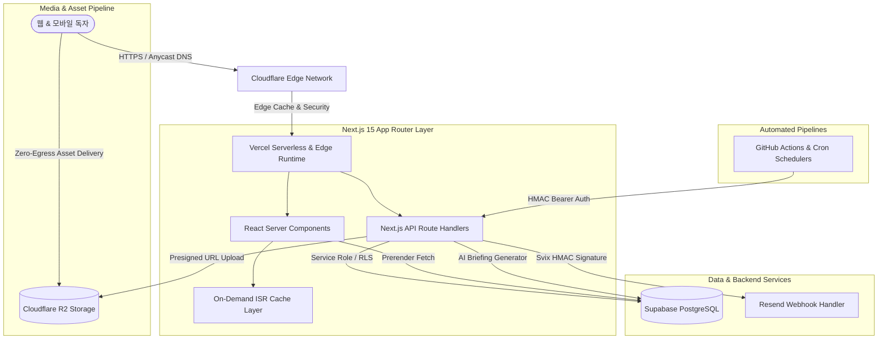

# 🏛️ 한국청년미디어 (KYM) 플랫폼 아키텍처 쇼케이스
> **Next.js 15 · Supabase · Cloudflare R2 · 고성능 On-Demand ISR 기반 차세대 디지털 뉴스룸 시스템**

본 저장소는 독립 온라인 저널리즘 미디어 플랫폼 **한국청년미디어(kym.io.kr)**의 프로덕션 시스템 아키텍처, 성능 최적화 전략 및 엔지니어링 설계를 소개하는 기술 쇼케이스입니다. (보안 및 개인정보 보호를 위해 비공개 핵심 소스코드를 제외한 인프라 및 시스템 설계 중심으로 구성되었습니다.)

---

## 📐 전체 시스템 아키텍처

---

## 🚀 핵심 엔지니어링 특징

### 1. On-Demand Incremental Static Regeneration (ISR) 최적화
- **정기 주기 캐시 만료(Time-based ISR)의 한계 극복**: 기사 발행 빈도가 비정기적인 미디어 특성에 맞춰 고정 시간 재검증 대신 기사 생성·수정 시점에만 태그 기반으로 즉시 무효화하는 온디맨드 재검증(`revalidateTag`) 체계 구축.
- **Vercel 무료 플랜 ISR 캐시 쓰기 한도 최적화**: 불필요한 백그라운드 캐시 재생성을 차단하여 월간 수백만 회의 불필요한 서버리스 함수 호출 및 데이터베이스 쿼리 방지.

### 2. 고성능 미디어 파이프라인 (Cloudflare R2)
- **Zero Egress 비용 구조**: 고해상도 취재 보도 사진 및 프레스 에셋을 Cloudflare R2에 분산 배치하여 무제한 외부 송출(Egress) 수수료 절감.
- **보안 다이렉트 업로드**: 백엔드 서버 부하를 최소화하기 위해 Supabase Auth 기반 관리자 세션 검증 후 S3 호환 사전 서명된 URL(Presigned URL)을 발급받아 R2로 직업로드하는 구조 채택.

### 3. 미디어 특화 프런트엔드 & 저널리즘 에디터 시스템
- **실시간 원고지 분량 계측**: 뉴스룸 편집기 내 200자 원고지 매수 및 단어 수 실시간 자동 산출.
- **인터랙티브 독자 여론조사 위젯**: `localStorage` 기반 중복 투표 방지 및 실시간 CSS 애니메이션 게이지를 갖춘 독자 참여형 정책 투표 시스템.
- **SEO & 오픈그래프 극대화**: JSON-LD NewsArticle 스키마 마크업, 자동 생성 동적 사이트맵(Sitemap), 네이버 웹마스터 및 Google Search Console 최적화 메타데이터 제공.

### 4. 엔터프라이즈 보안 및 무결성 보장
- **웹훅 보안 검증**: 메일 전송 플랫폼(Resend)의 웹훅 엔드포인트에 Svix 기반 암호화 서명 검증을 적용하여 스푸핑 공격 차단.
- **조회수 조작 방어**: 악의적인 무한 새로고침 및 F5 스패밍에 의한 통계 왜곡을 방어하기 위한 토큰 버킷 속도 제한 및 클라이언트 핑거프린팅.

---

## 🛠️ 기술 스택 상세

| 계층 | 사용 기술 | 선정 사유 |
|---|---|---|
| **Core Framework** | Next.js 15 (React 19, App Router) | 최신 React Server Components(RSC)를 통한 번들 크기 최소화 및 초기 렌더링 속도(FCP/LCP) 극대화 |
| **Language** | TypeScript 5.0 | 엄격한 타입 안정성 및 리팩토링 안정성 확보 |
| **Database & Auth** | Supabase (PostgreSQL 15) | 행 단위 보안(RLS) 정책 기반 다중 역할(발행인, 기자, 독자) 권한 제어 및 실시간 데이터 동기화 |
| **Object Storage** | Cloudflare R2 | AWS S3 대비 Egress 비용 전면 면제 및 전 세계 Anycast Edge 분산 가속 |
| **Styling** | Tailwind CSS, Lucide React | 반응형 미디어 레이아웃과 일관된 디자인 토큰 시스템 구축 |
| **Deployment** | Vercel Edge Network | 글로벌 Anycast 엣지 캐싱 및 무중단 CI/CD 배포 파이프라인 |

---

## 🌐 라이브 프로덕션

- **공식 웹사이트**: [https://kym.io.kr](https://kym.io.kr)
- **개발 및 총괄**: 김도형 (Kim Do-hyeong) · 한국청년미디어 창립자 & 발행인

---
© 2026 Kim Do-hyeong. All rights reserved.
